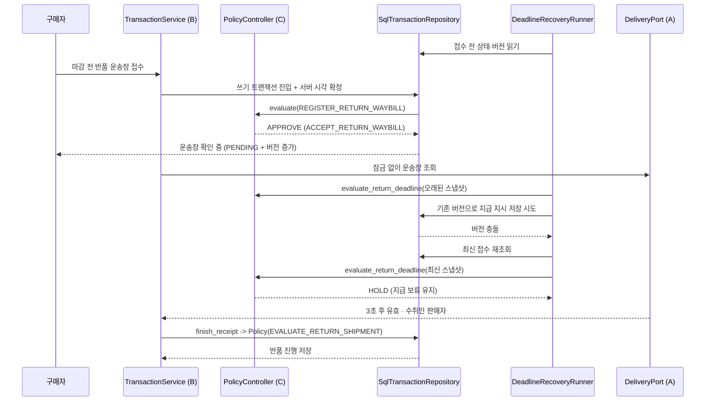

# QAS-01 · 반품 등록 마감과 판매자 지급 경합

기준은 팀 설계 산출물(`docs/artifacts/QAS-01md.md`, `docs/artifacts/dcd-integrated.puml`, `docs/artifacts/architecture-decision.md`, `docs/artifacts/qas-availability-recovery.md`)이다. 통합 DCD의 계층 책임과 C 정책 계약을 따르며, 데모 실행 경로는 QAS-01 반품 경합을 중심으로 구성했다.

| 항목 | 구현과 검증 |
| --- | --- |
| 환경 | 반품 승인·지급 보류 상태, 대금 100,000원. 최초 안내 게시 시각 + 경과 72시간에 마감. UTC 저장·화면 KST 표시. |
| 자극 | 마감 50ms 전 구매자 운송장 접수. 만료 작업은 접수 전 읽은 상태로 지급 시도. 택배 응답은 3초 후 도착. |
| 응답 | 접수·서버 시각·확인 중 상태·거래 버전을 같은 트랜잭션에서 저장. 만료 작업은 버전이 달라지면 최신 접수로 재판단하고 지급 보류. |
| 신뢰성 | 100건에서 판매자 지급 지시와 모의 은행 지급 각 0건. 미접수 → 확인 중 → 반품 진행. |
| 성능 | 공통 마감부터 100건 각각의 보류 결정까지 200ms 이내. 택배 대기 시간과 DB 잠금을 분리. 통제 시계 검증과 실제 자동 실행 검증을 구분. |

## 판정 규칙 (C 순수 정책 계층)

- 접수 시각 `< 마감`만 기한 내다(`DeadlinePolicy.is_before_deadline`). 정각과 이후(`DeadlinePolicy.is_due`)는 거절한다. 동일 요청 ID 재전송은 최초 접수 기록을 반환하며 접수 시각을 바꾸지 않는다.
- **접수 시각 선형화 기준**: 본 로컬 단일 프로세스 SQLite 구현에서는 DB 쓰기 트랜잭션(`BEGIN IMMEDIATE`) 진입 시점에 서버 시각을 확정해 `PolicyRequest.received_at`으로 C에 전달한다. 따라서 DB 잠금 대기 중 마감이 지나면 미접수로 거절된다. 다중 인스턴스 환경에서 `architecture-decision.md` §5의 "서버 최초 접수 시각"을 저장 완료 시각과 분리해 보장하는 분산 순서·대기 규칙은 다중 노드 확장 시 별도 적용 대상이다.
- 유효·확인 중·응답 없음·담당자 확인 대상 중 하나라도 기한 내 접수로 남으면 지급을 보류한다.
- 운송장이 유효하고 수취인이 판매자이면 반품 진행이다. 판매자에게 도착한 사실을 확인할 때까지 환불하지 않는다.
- 무효·수취인 불일치는 해당 접수만 거절한다. 마감 뒤 다른 유효·확인 중 접수가 없으면 지급한다.
- 응답 없음은 조회 전용 재시도로 처리한다. 총 3회 조회 후 담당자 확인(`MANUAL_REVIEW`)으로 넘기며 자동 지급하지 않는다. 데모에서는 회당 3초 응답 지연, 재조회 간격 1초다.
- 지급과 환불은 동일 원금 자리를 점유한다. `FundsPolicy`와 DB의 `UNIQUE(transaction_id)`로 원금 지시를 하나만 허용하고, 버전 검사와 지시 저장을 원자적으로 수행한다.
- 지시 저장 후 `BankPort`를 호출한다. 응답이 `UNKNOWN`이면 상태를 유지하고 같은 `requestKey`로 `get_transfer_result()`를 재조회하며, `FAILED`이면 `FundsPolicy` 판단에 따라 `MANUAL_REVIEW`로 전환한다.

## 동시 실행 순서

## 코드 대응

| DCD 책임 | 구현 |
| --- | --- |
| TransactionController / DeadlineRecoveryRunner | `backend/app/main.py`, `runner.py` — HTTP·마감·조회 진입점. 마감·택배 조회·은행 실행을 별도 비동기 작업으로 구성. |
| TransactionService (B) | `backend/app/service.py` — `TransactionPolicy`/`PolicyController` 호출, 버전 충돌 재판단, 외부 포트 호출 및 `UNKNOWN`/`FAILED` 복구 조정. |
| TransactionPolicy / PolicyController / 6개 정책 클래스 (C) | `backend/app/policy.py`, `domain.py` — 부수 효과 없는 순수 정책 판단(`DepositPolicy`, `FulfillmentPolicy`, `CancellationPolicy`, `ReturnPolicy`, `FundsPolicy`, `DeadlinePolicy`) 및 `PolicyRequest`/`PolicyContext`/`PolicyDecision`, 자금 기록 모델. |
| TransactionRepository / RequestGuard | `backend/app/repository.py` — 접수·버전·지시의 짧은 SQLite 트랜잭션, 조회 작업 점유(정책 판단은 C로 위임). |
| DeliveryPort / BankPort (A 계약·모의 구현) | `backend/app/domain.py` 계약, `adapters.py` 모의 구현(`TransferResult`, `TransferStatus`, `LookupStatus` 포함). |

## 검증 범위

`backend/tests`가 오래된 만료 읽기, 100건 및 1,000건 경합, 실제 마감 러너, 마감 1ms 전·정각·1ms 후, 여러 운송장, 수취인 불일치, 무응답·조회 한도, 요청 중복, 원금 중복 지시, 접수 영속화, 점유 인계, 환불 도착 조건, API 양측 상태, 통합 DCD의 `TransactionPolicy` 5종·6개 C 정책 클래스·은행 `UNKNOWN`/`FAILED` 복구 경로를 검증한다. 운영 부하·다중 서버·실제 금융/택배 연동의 성능 보증은 이 로컬 데모 결과에 포함하지 않는다.

## 강화된 성능 · 정합성 · 장애 복구 기준

기존 QAS-01(100건, 200ms)에 더해 금전 시스템 신뢰성 검증을 위해 아래 3축 기준을 추가 구현·검증했다.

| 축 | 강화 기준 | 구현 및 검증 위치 | 로컬 실측 결과 |
| --- | --- | --- | --- |
| **1. 성능 (Tail Latency & Bulkhead)** | 1,000건 동시 경합에서 개별 결정 `p95 ≤ 50ms`, `p99 ≤ 100ms`, `max ≤ 200ms` / 외부 100% 타임아웃 중 독립 접수·조회 API `p99 ≤ 50ms` | `backend/app/benchmark.py` (`run_qas01_stress`), `POST /api/demo/qas-01/stress`, `test_chaos_and_invariants.py` | 1,000건: `p50 1.47ms`, `p95 1.87ms`, `p99 2.39ms`, `max 4.23ms`, 지급 0건 / 외부 전면 장애 중 독립 API `p99 ≤ 50ms` |
| **2. 관계적 정합성 (Invariants)** | 전 DB·모의 은행 원장 자동 대조에서 모순 레코드 **0건** (원금 배타성, 인과 순서, DB↔은행 원장 대칭차집합 `∅`, 단조 버전, 자금 보존 법칙) | `backend/app/invariants.py` (`InvariantChecker`, `verify_money_conservation`) | 100건·1,000건 벤치마크 및 모든 Chaos 시나리오 위반 **0건** |
| **3. 장애 주입 복구 (Chaos)** | 4개 크래시 지점(접수 직후·택배 대기 중·지시 저장 직후·응답 유실 `UNKNOWN`)에서 **RPO=0, RTO ≤ 5초, 중복 이체 0건**, 좀비 워커 Fencing 차단, UI↔DB 단조 읽기·양측 대칭성 | `backend/tests/test_chaos_and_invariants.py` | 4개 크래시 지점·전면 장애 Fail-Safe·좀비 워커 차단·양측 뷰 일치 **전원 통과** |

