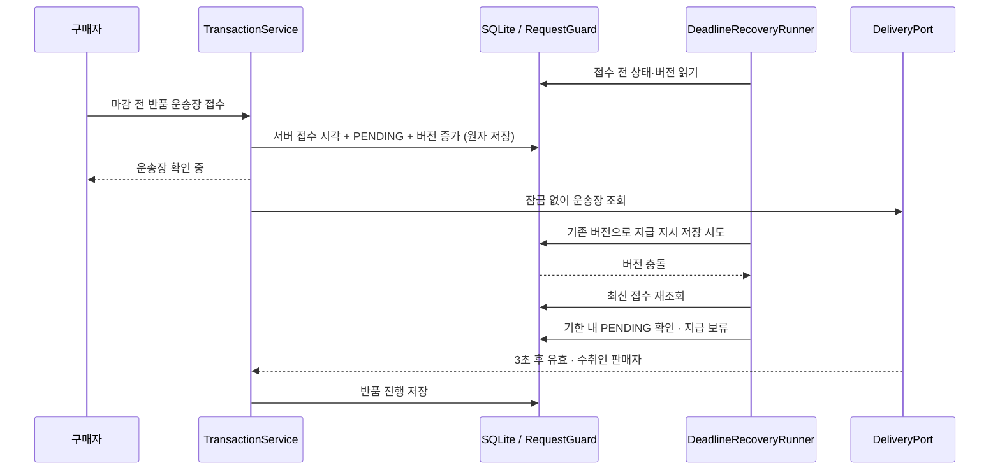

# QAS-01 · 반품 등록 마감과 판매자 지급 경합

기준은 팀 설계 저장소의 `docs/QAS-01md.md`, `docs/통합/dcd-integrated.puml`, `docs/통합/architecture-decision.md`, `docs/C-최종범위-실행계획.md`다. 통합 DCD의 클래스 책임을 따르고 반품 경합에 필요한 부분만 구현했다.

| 항목 | 구현과 검증 |
| --- | --- |
| 환경 | 반품 승인·지급 보류 상태, 대금 100,000원. 최초 안내 게시 시각 + 경과 72시간에 마감. UTC 저장·화면 KST 표시. |
| 자극 | 마감 50ms 전 구매자 운송장 접수. 만료 작업은 접수 전 읽은 상태로 지급 시도. 택배 응답은 3초 후 도착. |
| 응답 | 접수·서버 시각·확인 중 상태·거래 버전을 같은 트랜잭션에서 저장. 만료 작업은 버전이 달라지면 최신 접수로 재판단하고 지급 보류. |
| 신뢰성 | 100건에서 판매자 지급 지시와 모의 은행 지급 각 0건. 미접수 → 확인 중 → 반품 진행. |
| 성능 | 공통 마감부터 100건 각각의 보류 결정까지 200ms 이내. 택배 대기 시간과 DB 잠금을 분리. 통제 시계 검증과 실제 자동 실행 검증을 구분. |

## 판정 규칙

- 접수 시각 `< 마감`만 기한 내다. 정각과 이후는 거절한다. 동일 요청 ID 재전송은 최초 접수 기록을 반환하며 접수 시각을 바꾸지 않는다.
- 유효·확인 중·응답 없음·담당자 확인 대상 중 하나라도 기한 내 접수로 남으면 지급을 보류한다.
- 운송장이 유효하고 수취인이 판매자이면 반품 진행이다. 판매자에게 도착한 사실을 확인할 때까지 환불하지 않는다.
- 무효·수취인 불일치는 해당 접수만 거절한다. 마감 뒤 다른 유효·확인 중 접수가 없으면 지급한다.
- 응답 없음은 조회 전용 재시도로 처리한다. 총 3회 조회 후 담당자 확인으로 넘기며 자동 지급하지 않는다. 데모에서는 회당 3초 응답 지연, 재조회 간격 1초다.
- 지급과 환불은 동일 원금 자리를 점유한다. DB의 `UNIQUE(transaction_id)`로 원금 지시를 하나만 허용하고, 버전 검사와 지시 저장을 원자적으로 수행한다.
- 지시 저장 후 모의 은행을 호출한다. 모의 은행도 같은 원금과 요청 키를 영속적으로 중복 방지한다. 실제 은행 연동에는 같은 멱등 계약이 필요하다.

## 동시 실행 순서

## 코드 대응

| DCD 책임 | 구현 |
| --- | --- |
| TransactionController / DeadlineRecoveryRunner | `backend/app/main.py`, `runner.py` — HTTP·마감·조회 진입점. 마감·택배 조회·은행 실행을 별도 비동기 작업으로 구성. |
| TransactionService | `backend/app/service.py` — 정책 호출·버전 충돌 재판단·외부 호출 조정. |
| PolicyController / ReturnPolicy / DeadlinePolicy | `backend/app/domain.py` — 부수 효과 없는 기한·반품 판단. |
| TransactionRepository / RequestGuard | `backend/app/repository.py` — 접수·버전·지시의 짧은 SQLite 트랜잭션, 조회 작업 점유. |
| DeliveryPort / BankPort | `backend/app/domain.py` 계약, `adapters.py` 모의 구현. |

## 검증 범위

`backend/tests`가 오래된 만료 읽기, 100건 경합, 실제 마감 러너, 마감 1ms 전·정각·1ms 후, 여러 운송장, 수취인 불일치, 무응답·조회 한도, 요청 중복, 원금 중복 지시, 접수 영속화, 점유 인계, 환불 도착 조건, API 양측 상태를 검증한다. 운영 부하·다중 서버·실제 금융/택배 연동의 성능 보증은 이 로컬 데모 결과에 포함하지 않는다.
